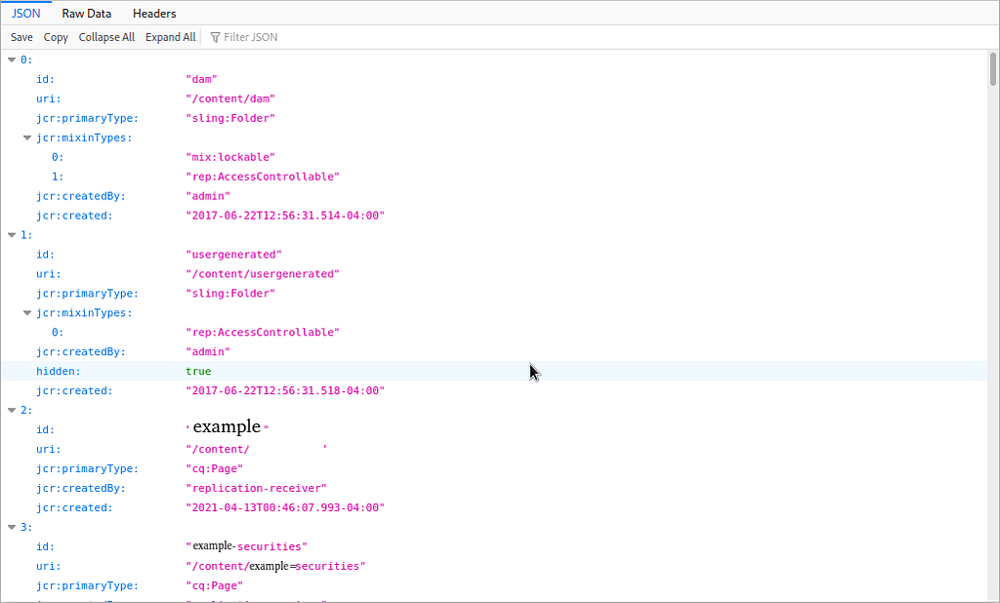
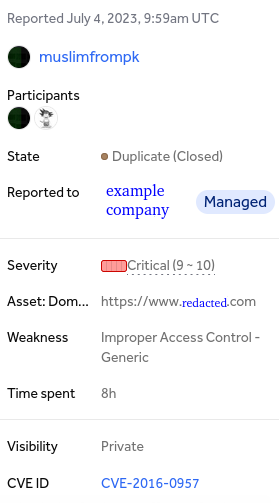
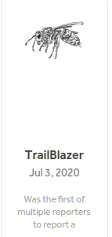
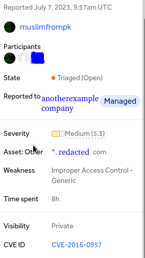

Assalam-O-Alaikum!

Hello amazing hackers! Today I am here with another little but interesting story of how I found my first P1 vulnerability on a VDP program by bypassing Adobe dispatcher in Adobe Experience Manager CMS.So lets break it down.

## What is Adobe Experience Manger?

Adobe Experience Manager is a CMS(Content Management System) like WordPress and Drupal(I have not seen Drupal till now:-)). As you all know that WordPress has many vulnerabilities (no problem if you don't know I will break it in another write-up if you like)

## What is Adobe Dispatcher?

Adobe Dispatcher is like a Firewall in our words I think it gives us a 403 error on sensitive directories.

## How I found this vulnerability?

I am beginner so I follow a methodology of and on.I just browsed the website and opened Wappalyzer to see what technologies are in use.It show CMS as first heading and Adobe Experience Manager as the technology.If I say truth I didn't saw other technologies and just jumped into Google search bar and searched for "AEM( shorthand for Adobe Experience Manager) Vulnerabilities" I saw a couple of medium articles on this.I often look for medium articles unlike others because they often very useful than others.I opened first article but it was of someone like me so I went back and opened second article of Clarkvoss it was a mystery box I would suggest you to bookmark it because it will help you when ever you faced with Adobe Experience Manager.

> **[The CVE That Will Never Die!](https://clarkvoss.medium.com/the-cve-that-will-never-die-86149b450840)**<br>
> Article by Clarkvoss on Medium

So I tried those techniques and one worked for me. I was able to access all of the websites internal sensitive files and directories by appending

**.*children.400.json***

at the end like

```
https://example.com/content/.children.400.json
```

and the result


*This is not all but for security reasons I cannot share all information*

## Steps to reproduce:

Here are the steps how I can reproduce the vulnerability as described to their team

1. Go to `https://www.example.com`
2. Change the URL to `https://www.example.com/directory-name-here/.json` (change the *directory-name-here* to a valid directory name for example *content* directory)
3. Observe that directory information is displayed if the directory exists
4. Now change the URL to `https://www.example.com/content/.children.1.json` .it will list all the sub-directories and files

Note:You can list the contents of sub-directories and files by appending them after the parent directory's name and then /.children.number.json for example to list contents of dam sub-directory you can use `https://www.example.com/content/dam/.children.1.json`.

And the result of my report was not very bad



It has two benefits the first is that I got a new spirit and appreciation that I have found my first valid P1 bug and the second benefit is to the reporter early reporter of this report because he will get a badge of appreciation like this one.


*HackerOne badge*

So this was the story of my first P1 vulnerability and I happy to have this because don't be stressful if you get a duplicate because it shows that you have found a valid bug and as Zseano says **"Bounty and reward is just a bonus"**

**STOP here's an edit:**


*My first ever report got triaged due to CVE-2016–0957*

It's severity was critical but the triager changed it to medium because he calculated its CVSS score wrongly and it got triaged in one hour so I was unable to talk about severity, anyway I am very happy.

I hope that you will have found something new to learn from this write-up.

As you know I am not a native English speaker so there are tons of grammar and spelling mistakes and I like creativity so I don't use a grammar checker or paraphraser tool.So please forgive me for these errors

If you have question about bug-bounty and hacking or want a fellow colleague you can ping me on twitter:[@muslimfrompk](https://twitter.com/muslimfrompk)

> Assalam-O-Alaikum & and **"Allah"** bless you
